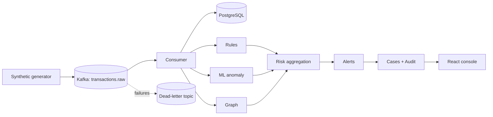

# AML Transaction Monitoring & Investigation Platform

An event-driven anti-money-laundering (AML) platform: it consumes payment events, scores them with
rules, an anomaly model and graph analysis, creates explainable alerts, and gives investigators an
auditable case-review workflow.

> **Important:** This is an educational reference project built on **synthetic data**. It is not a
> certified or production-ready compliance system. Scores prioritise human review and are never a
> finding of criminal conduct. Nothing here files regulatory reports.

## What it does
- Ingests transactions through a REST API and a Kafka-compatible queue; duplicate events are ignored
- Runs six versioned scenarios: high velocity, possible structuring, rapid in-and-out movement,
  fan-in then fan-out, profile mismatch, dormant-account activation
- Computes 35 rolling behavioural features and scores them with an Isolation Forest
- Builds a 24-hour account graph (NetworkX) for fan-in/fan-out shape, nearby cycles, flagged neighbours
- Combines the signals into one score and creates alerts that store the evidence, rule versions and model version
- Provides an investigator console: alert queue, alert detail with network graph, cases, notes, dispositions,
  customer view, scenario management and model monitoring
- Enforces roles (analyst, senior investigator, compliance officer, administrator, auditor) and keeps an
  append-only audit log

## Architecture

Design decisions are in [docs/architecture.md](docs/architecture.md).

**Score:** `0.45 × rules + 0.30 × anomaly + 0.15 × graph + 0.10 × customer risk`. The weights and the
0.5 alert threshold are illustrative and would need calibration on real data.

## Results (synthetic data)
| Measure | Value |
|---|---|
| Transactions processed | <8000
| Alerts created / per 10,000 transactions | 50 |
| Alerts by severity (low / medium / high) | Multiple |
| Planted layering scenario detected |  yes, alerts on the mule accounts |
| Precision of alerts on live events / precision@10 | <fill> / <fill> |
| Event-to-alert latency p50 / p95 / p99 | <fill> / <fill> / <fill> seconds |
| Dead-letter events | 0 |
| Model drift (PSI) |  |
| Automated tests | 12 pytest passed|1 pywright end to end passed |

These numbers come from one planted pattern in synthetic data. They show that the pipeline works,
not how it would perform on real transactions.

## Tech stack
Python, FastAPI, Pydantic, SQLAlchemy, Alembic, PostgreSQL, Redpanda (Kafka API), Redis, scikit-learn,
pandas, NetworkX, React, TypeScript, Vite, Tailwind CSS, React Query, Recharts, Prometheus, Grafana,
pytest, Playwright, Docker, GitHub Actions.

## Run it locally
Requires Docker Desktop, Python 3.11+ and Node 20+. Commands are for Git Bash.
```bash
git clone https://github.com/Sameers02003/aml-transaction-monitoring.git
cd aml-transaction-monitoring
docker compose up -d
docker compose exec redpanda rpk topic create transactions.raw transactions.dlq -p 3
docker compose exec postgres createdb -U aml aml_test

cd apps/api
python -m venv .venv
source .venv/Scripts/activate        # Mac/Linux: source .venv/bin/activate
pip install -r requirements.txt
cp ../../.env.example .env           # then set JWT_SECRET to a long random string
alembic upgrade head
touch scripts/__init__.py
python -m scripts.seed
python -m scripts.generate seed
python -m scripts.generate history
python ../../ml/pipelines/train.py
```
Then start three terminals:
```bash
# 1) API (inside apps/api, venv active)
uvicorn app.main:app --reload --host 0.0.0.0
# 2) Consumer (inside apps/api, venv active)
python -m app.workers.consumer
# 3) Web
cd apps/web && npm install && npm run dev
```
Stream the demo scenario with `python -m scripts.generate live` (inside `apps/api`), then open
http://localhost:5173. API docs: http://localhost:8000/docs. Grafana: http://localhost:3000.

Demo logins (synthetic, local only): `analyst1` / `analyst1-demo`, `senior1` / `senior1-demo`,
`compliance1` / `compliance1-demo`, `admin1` / `admin1-demo`, `auditor1` / `auditor1-demo`.

## Project structure
```
apps/api      FastAPI app, workers, migrations, scripts, tests
apps/web      React investigator console, Playwright test
ml/           training and evaluation scripts, feature definitions, model notes
infra/        Dockerfiles, Prometheus config, Kafka and Postgres notes
data/         event schema and notes on the synthetic data
docs/         architecture, scenarios, threat model, runbook, screenshots
```
The original blueprint proposed separate `stream-consumer`, `feature-jobs` and `model-scoring` services.
This project is a modular monolith instead: the consumer is `apps/api/app/workers/consumer.py`, features are
in `apps/api/app/modules/scoring/features.py` plus `ml/pipelines`, and model scoring is
`apps/api/app/modules/scoring/anomaly.py`.

## API overview
Transactions are accepted with an API key. Everything else needs a login token and a permitted role.
Main endpoints: `POST /api/v1/transactions`, `POST /api/v1/auth/login`, `GET /api/v1/alerts`,
`GET /api/v1/alerts/{id}`, `POST /api/v1/alerts/{id}/assign`, `POST /api/v1/cases`,
`POST /api/v1/cases/{id}/notes`, `POST /api/v1/cases/{id}/disposition`,
`GET /api/v1/customers/{id}/risk-summary`, `GET /api/v1/metrics/aml`, `GET /api/v1/rules`.

## Testing and CI
`cd apps/api && python -m pytest -q` runs rule boundary tests, negative cases, idempotency, deduplication,
and role checks. `cd apps/web && npx playwright test` runs a browser test of the analyst workflow.
GitHub Actions runs linting, the API tests and the web build on every push.

## Limitations
- Synthetic data only; one planted scenario; single currency (INR)
- Weights, thresholds and rules are demo values, not validated or regulator-approved
- No MFA, TLS, secrets manager, retention policy, sanctions screening or formal model validation
- The graph is rebuilt per transaction on a 24-hour window, which is fine here but not for large volumes
- Precision and recall are approximate because alerts are deduplicated

## Future work
Corridor-risk scenario, labelled feedback from dispositions to retrain the model, a streaming processor
for event-time windows, a graph database for heavier traversal, and a model registry with approval steps.

## References
Regulatory context (consult the current official publications and a compliance team before relying on any of it):
[RBI](https://www.rbi.org.in/) KYC Master Direction, [FATF](https://www.fatf-gafi.org/) Recommendations,
[FinCEN](https://www.fincen.gov/) suspicious activity reporting guidance.