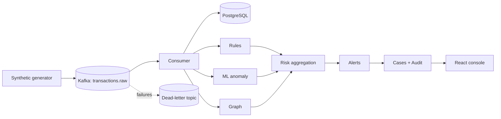

# Architecture

## Components
| Part | Technology | Why |
|---|---|---|
| API | FastAPI + Pydantic | Python ecosystem for ML, clear contracts |
| Database | PostgreSQL | Integrity for transactions, alerts, cases, audit |
| Event log | Redpanda (Kafka API) | Durable, replayable, decouples ingestion from scoring |
| Cache and limits | Redis | Login rate limit; not an authoritative store |
| ML | scikit-learn Isolation Forest | Works without labels; reasons come from computed features |
| Graph | NetworkX on a 24-hour window | Enough for a bounded window; a graph database is for heavier traversal |
| UI | React + TypeScript + Tailwind | Investigator console |
| Observability | Prometheus + Grafana | Latency, throughput, dead letters |

## Decisions
- Modular monolith with one database and Kafka as the event boundary, rather than many microservices.
- Money is stored as NUMERIC; event IDs are unique so replays are harmless (at-least-once delivery plus idempotency).
- Windows use event time (occurred_at), so replays behave the same as live traffic.
- The score prioritises review; humans decide. Every alert stores components, weights, versions and evidence.

## Scoring
overall = 0.45 rule + 0.30 anomaly + 0.15 graph + 0.10 customer risk. Weights and the 0.5 threshold are illustrative and must be calibrated on real data.